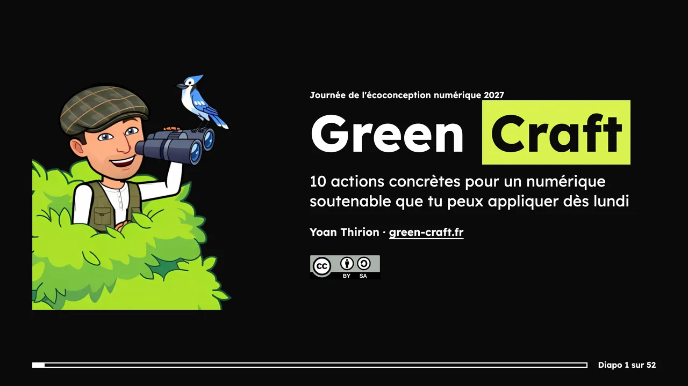
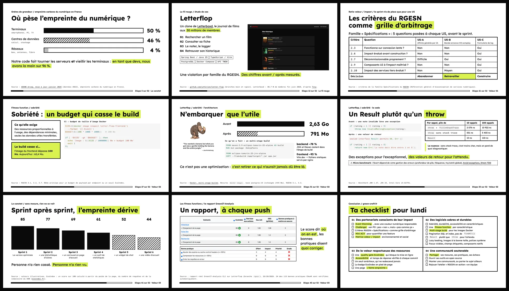

# Green Craft : 10 actions concrètes pour un numérique soutenable que tu peux appliquer dès lundi

[](https://github.com/ythirion/journee-econception2027/actions/workflows/slides.yml)
[](https://creativecommons.org/licenses/by-sa/4.0/deed.fr)



Slides du talk présenté par [Yoan Thirion](https://www.linkedin.com/in/yoanthirion/) à la **Journée de l'écoconception numérique 2027** (30 min + 10 min de questions).

## Contexte
Je viens du dev, et plus exactement du monde du **Software Craftsmanship**. Depuis une dizaine d'années, une question me suit : comment rendre le logiciel que l'on construit plus responsable, sans attendre qu'on nous le demande ?

Le talk part des quatre valeurs du manifeste du Software Craftsmanship et les prolonge vers le numérique responsable, avec le [manifeste Green Craft](https://green-craft.fr). Pour chaque valeur : des pratiques concrètes, mesurées sur un fil rouge, **Letterflop** ([code](https://github.com/ythirion/letter-flop)), un clone de Letterboxd.

1. **Des partenariats conscients de leur impact** : Event Storming avec une couleur éco / accessibilité, les critères du RGESN comme grille d'arbitrage des user stories.
2. **Des logiciels bien conçus, et aussi sobres et durables** : sobriété, durabilité et accessibilité comme caractéristiques d'architecture, des fitness functions qui cassent le build, des gains mesurés sur Letterflop (image Docker −70 %, +77 % de requêtes par seconde).
3. **De la valeur respectueuse des ressources** : un contrôle EcoIndex dans la CI, des benchmarks plutôt que des intuitions, un score affiché publiquement.
4. **Une communauté dédiée à un numérique soutenable** : partager ses mesures, ses pratiques, ses outils, et aussi ses échecs.

Le talk se termine par une **checklist pour lundi** et une invitation à pratiquer avec l'atelier [Le numérique responsable en action](https://github.com/ythirion/rgesn-en-action).

Le public visé n'est pas uniquement développeur : les slides restent lisibles par toute personne qui fabrique du numérique (PO, designers, managers…).

## Aperçu


## Lancer les slides
En ligne : **https://ythirion.github.io/journee-econception2027/**

Les slides sont construites avec [Slidev](https://sli.dev) et un thème local (`slides/theme`).

```bash
cd slides
npm install
npm run dev     # http://localhost:3030
npm run build   # build statique dans dist/
npm run export  # export en PDF
```

## Licence
Ce contenu est mis à disposition selon les termes de la licence [Creative Commons Attribution - Partage dans les mêmes conditions 4.0 International (CC BY-SA 4.0)](https://creativecommons.org/licenses/by-sa/4.0/deed.fr) : tu peux le réutiliser et l'adapter, y compris à des fins commerciales, en citant l'auteur et en partageant tes adaptations sous la même licence. Texte complet dans [LICENSE](LICENSE).

Les images et contenus tiers cités dans les slides (logos, captures, extraits de sources) restent la propriété de leurs auteurs respectifs.
